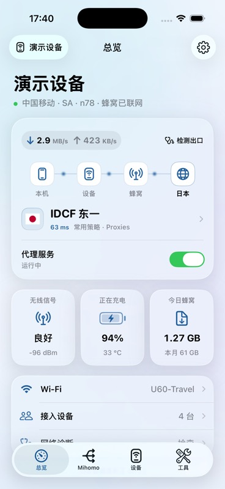
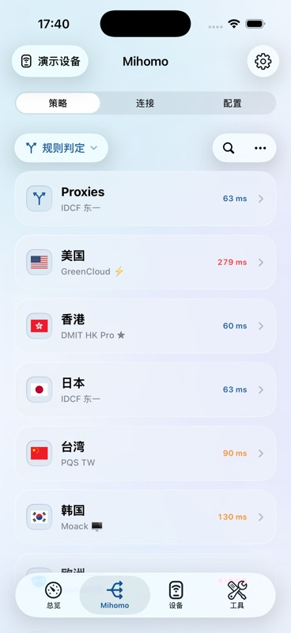
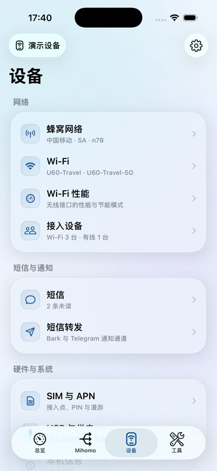
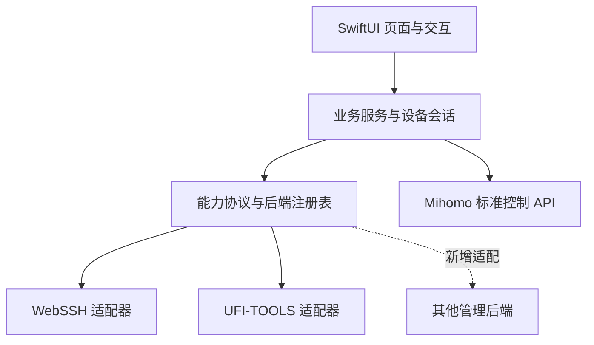

<p align="center">
  
</p>

<h1 align="center">FlowDeck · 驭流</h1>

<p align="center">
  <strong>中兴随身 Wi-Fi 与 Mihomo 的原生 iOS 管理客户端</strong>
</p>

<p align="center">
  <a href="https://github.com/AS9929/FlowDeck/actions/workflows/ci.yml"></a>
  
  
  <a href="LICENSE"></a>
</p>

<p align="center">
  <a href="#功能概览">功能概览</a> ·
  <a href="#设备兼容">设备兼容</a> ·
  <a href="#开始使用">开始使用</a> ·
  <a href="#构建与开发">构建与开发</a> ·
  <a href="CONTRIBUTING.md">参与贡献</a>
</p>

FlowDeck 将网络状态、Mihomo 策略与设备维护整合到同一个 App。连接随身 Wi-Fi 后，
即可查看流量与信号、切换节点、管理无线网络，并完成配置编辑、诊断和适配范围内的维护操作。

目前提供 **WebSSH + Mihomo** 与 **UFI-TOOLS + Mihomo** 两种接入方式。
代理核心运行在随身 Wi-Fi 上，FlowDeck 负责连接与管理设备端服务。

<table>
  <tr>
    <td align="center" width="33%"><strong>总览</strong><br><sub>网络路径、实时流量与设备状态</sub></td>
    <td align="center" width="33%"><strong>Mihomo</strong><br><sub>策略、连接与配置</sub></td>
    <td align="center" width="33%"><strong>设备</strong><br><sub>无线网络与原厂功能</sub></td>
  </tr>
  <tr>
    <td></td>
    <td></td>
    <td></td>
  </tr>
</table>

<p align="center"><sub>截图来自 iOS 26.2 模拟器的演示模式，使用示例数据。实际入口随设备与接入方式变化。</sub></p>

## 功能概览

### 网络状态，一屏掌握

实时上传与下载速率、蜂窝信号、电量与温度集中呈现；从手机、设备到网络出口的路径可视化，
配合常用策略和快捷入口，快速判断当前连接状态。

### Mihomo，原生操作

管理策略组与节点、切换规则／全局／直连模式，查看连接和实时日志。
配置文件支持导入与编辑，常用策略偏好按设备保存，并与小组件、快捷指令共享。

### 设备管理，按能力呈现

在同一套界面中访问 Wi-Fi、接入设备、短信、SIM/APN、USB 与供电等功能。
App 根据接入方式和设备能力展示入口；后端适配器负责处理认证、固件差异和写入校验。

### 诊断与维护，保留操作上下文

区分管理连接、蜂窝网络、代理 TCP、DNS、设备 UDP 与手机 UDP 出口，展示各项探测的结果和范围。
已适配的维护流程提供配置备份、内核更新与恢复，并在写入前核验设备身份和兼容性。

### 为 iPhone 设计

SwiftUI 原生界面，支持浅色／深色外观、替代 App 图标、小组件与快捷指令。
iOS 26 使用 Liquid Glass，较早系统使用材质回退。未绑定、离线与演示状态各有明确入口。

## 设备兼容

兼容性以 **设备型号、固件、接入方式和服务布局** 的组合为单位。

| 接入方式 | 当前验证组合 | 管理通道 |
| :--- | :--- | :--- |
| **WebSSH + Mihomo** | 中兴 U60 Pro · MU5250 · B28 | WebSSH、原厂接口、Mihomo 控制 API |
| **UFI-TOOLS + Mihomo** | 中兴 F50 · MU300 · B09 · UFI-TOOLS 4.1.5 | UFI 管理通道、原厂接口、Mihomo 控制 API |

> [!IMPORTANT]
> FlowDeck 接入已部署好服务的设备。首次 Root、刷机及设备端安装仍需通过电脑完成。
> 安装了相同组件，不代表其他型号或固件已经兼容；具体写入能力还会校验设备身份、固件和服务布局。

两种接入方式共享 Mihomo 管理体验，原厂管理与维护能力按各自适配情况提供。
欢迎通过 [设备适配 Issue](https://github.com/AS9929/FlowDeck/issues/new?template=adapter.yml)
提交新的设备组合与脱敏接口信息。

## 开始使用

1. **连接设备热点**：确认手机能够访问随身 Wi-Fi 的管理地址，设备端已运行对应管理服务和 Mihomo。
2. **添加设备**：在“我的设备”中选择 WebSSH + Mihomo 或 UFI-TOOLS + Mihomo，填写地址、端口与对应凭据。
3. **验证并保存**：完成设备身份和服务连接验证后，进入总览、Mihomo、设备或工具页面开始管理。

WebSSH 密码／UFI 管理口令、Mihomo Secret、原厂网页密码是不同凭据，分别保存在本机钥匙串。
Wi-Fi、短信等原厂功能可能需要另行验证原厂后台密码。

没有设备时，可以主动开启**演示模式**体验页面与交互。演示数据不代表真实连接结果。

<details>
<summary><strong>常用策略、网络出口与本机数据</strong></summary>

- 在 **Mihomo → 策略操作（…）→ 常用策略组** 中设置首页、小组件和快捷指令关注的策略组。
  偏好按设备隔离；多组无法明确识别时，App 会提示选择。
- 规则模式按请求分流，常用策略的选中节点不代表所有连接的实际出口。
  手机 UDP 探测验证当前请求的往返与出口，不代表所有 UDP 流量均走代理。
- 移除同一硬件的最后一条连接记录时，会清理其本机 Wi-Fi/APN 恢复副本、短信草稿和策略偏好，
  不修改路由器上的设置。

</details>

## 构建与开发

需要 **macOS、Xcode 26 和 XcodeGen**，最低部署目标为 **iOS 17**。
普通 iOS 构建不需要 Android SDK、真实设备或私有凭据。

```sh
git clone https://github.com/AS9929/FlowDeck.git
cd FlowDeck
brew install xcodegen
xcodegen generate
open FlowDeck.xcodeproj
```

选择 `FlowDeck` Scheme 和 iPhone 模拟器运行。真机构建需要配置自己的签名身份；
完整步骤、测试命令和 Android 桥接重建方法见 [开发指南](docs/Development.md)。

### 为后续接入保留边界



页面依赖能力协议，业务服务承载完整操作流程，适配器封装设备端协议。
新增接入方式需要实现对应能力、兼容性检查和测试，再注册到 `BackendRegistry`；
标准 Mihomo 页面可以继续复用。分层约定和目录职责见 [代码结构](docs/CodeStructure.md)。

CI 检查公开交付边界、Git 历史密钥、工程生成一致性、iOS 单元测试、宿主事务测试、Release 构建，
以及 Android 桥接产物的源码重建一致性。现场凭据测试默认跳过，真实设备读写与热点联网需单独验收。

## 文档与参与

| 入口 | 内容 |
| :--- | :--- |
| [开发指南](docs/Development.md) | 环境、签名、构建、测试与资源生成 |
| [代码结构](docs/CodeStructure.md) | 模块职责、会话与状态所有权、新后端扩展约定 |
| [贡献指南](CONTRIBUTING.md) | 问题反馈、改动范围与提交验证 |
| [安全政策](SECURITY.md) | 漏洞报告与敏感信息处理 |
| [第三方许可](THIRD_PARTY.md) | 上游项目、资源出处和分发边界 |
| [发布检查](docs/ReleaseChecklist.md) | 源码、资源与发布前验证 |

欢迎改进交互与可访问性、补充协议测试，或为新设备提供独立适配。
反馈问题时请附上 App 版本、设备型号、固件与接入方式，并移除订阅、Secret、密码和设备标识。

## 致谢与许可

感谢 [Mihomo](https://github.com/MetaCubeX/mihomo)、
[WebSSH-u60pro](https://github.com/Jack-bin183/WebSSH-u60pro) 和
[UFI-TOOLS](https://github.com/kanoqwq/UFI-TOOLS) 提供设备端能力与开放接口，
以及 Simple Icons、Lobe Icons、flag-icons 的图标资源。

FlowDeck 自有源码与原创资源采用 [MIT License](LICENSE)。
第三方内容遵循 [各自许可证](THIRD_PARTY.md)，相关名称和商标归各自权利人。
本仓库不分发设备固件、首次部署安装包、Mihomo 核心二进制或个人订阅。
